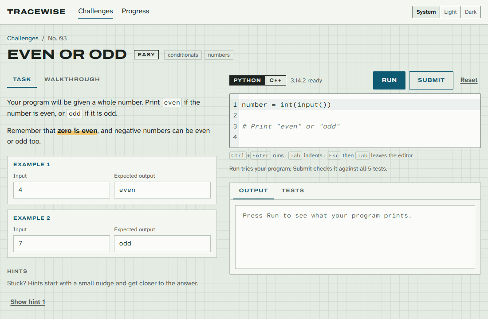
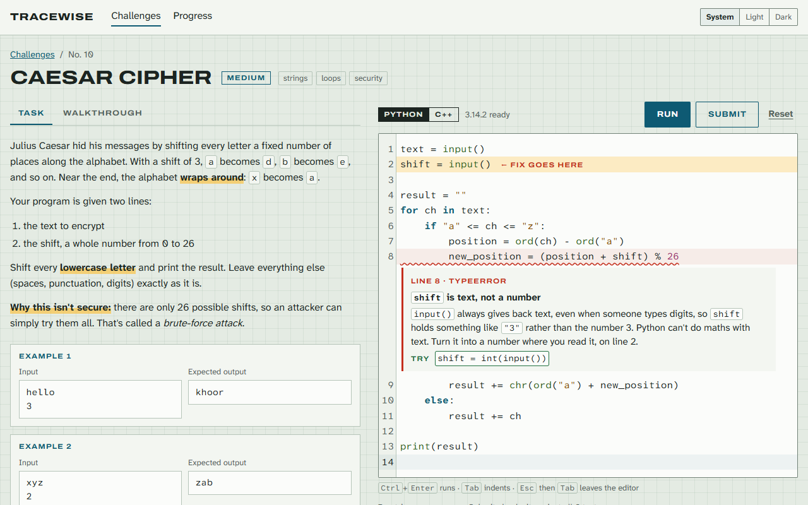
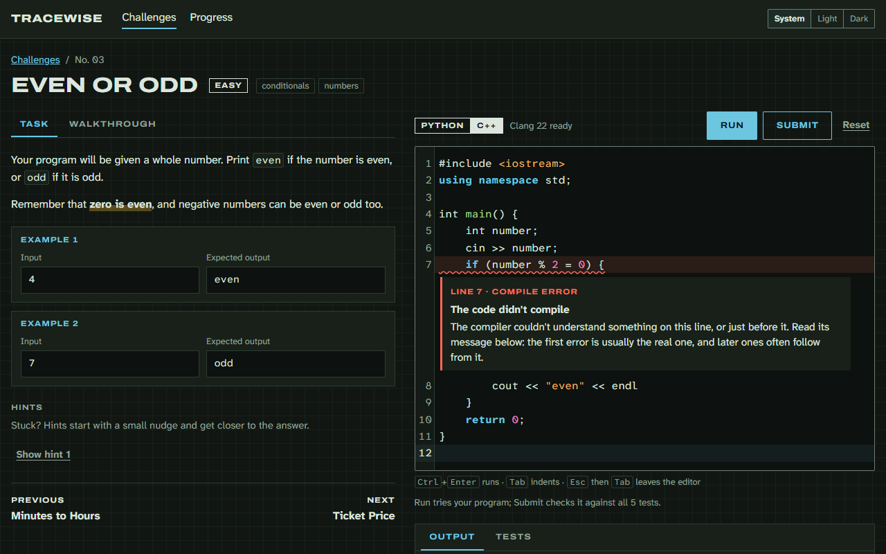
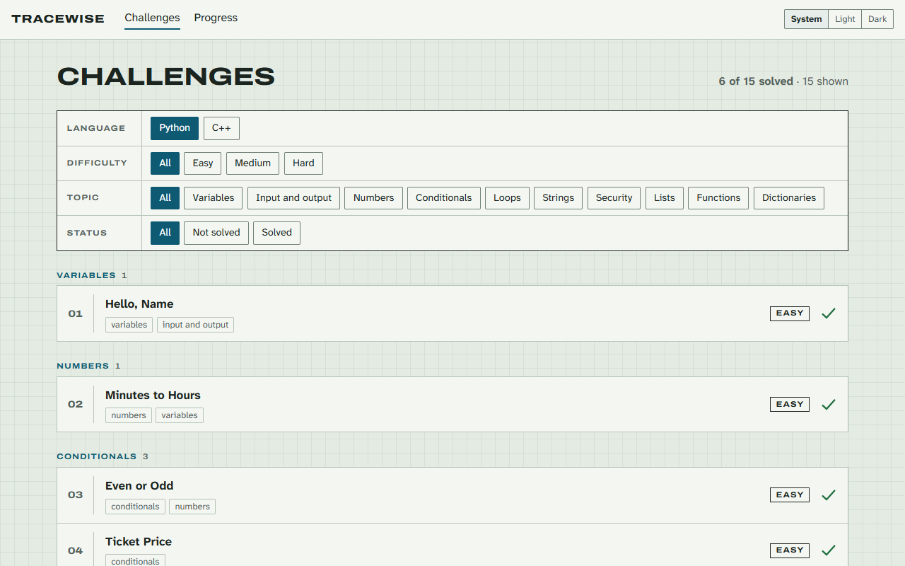
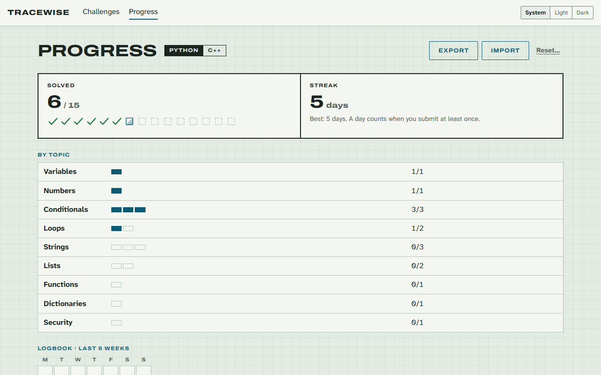

# Tracewise

Practise **Python** and **C++** in your browser by solving beginner-friendly challenges. Your code runs on your own machine, with hidden tests, progressive hints, solution walkthroughs, and a friendly explainer that turns error messages into plain language. No install, no account, nothing sent to a server.

**Try it: [tracewise-code.netlify.app](https://tracewise-code.netlify.app)**



| An error explained on the line | A C++ compile error, in dark mode |
|---|---|
|  |  |
| **Challenge list with filters** | **Progress, streak and logbook** |
|  |  |

## Features

- **15 beginner challenges**, each solvable in **Python** or **C++**: variables, numbers, conditionals, loops, strings, lists, functions, dictionaries and two security puzzles
- **Runs in your browser:** Python 3.14 through Pyodide, and C++20 compiled by a real Clang 22, both in Web Workers with live output, interactive input, a Stop button and a time limit
- **Submit** checks your code against hidden tests, with ticks and crosses, expected-vs-your-output comparison, and near-miss notes (capital letters, spacing, `5.0` vs `5`, extra or missing lines)
- **Friendly error explainer:** 74 rules (46 for Python, 28 for C++) turn error messages into plain language, shown as a red-pen note on the line that went wrong, and on the line where the fix goes
- **Progressive hints** as margin notes, from a small nudge to nearly the answer, and a walkthrough you can reveal
- **Progress saved in your browser:** your code, solved marks, hints used and a daily streak, with a Progress page, a 6-week logbook, and export / import to a file
- **Filters** for language, topic, difficulty and solved status, kept in the URL so a filtered list can be shared
- **Works on phones:** side-by-side on desktop, tabs (Problem / Code / Output) on small screens, with 44 px tap targets on touch screens
- **Light and dark themes** that follow your system, or that you can pick yourself
- **Accessible:** keyboard-only use (with a way to leave the editor with Esc then Tab), visible focus, a skip link, WCAG AA text contrast, and screen-reader labels for tests and notes

## Design

The look is called **Drafting pad**: green-grey engineering-pad paper with a faint grid, graphite ink, a petrol-blue pen for actions, a red pen reserved for mistakes, and a highlighter for hints. Headings are set in **Archivo Expanded**, like the title block of a technical drawing. Body text and code use **Atkinson Hyperlegible Next** and **Atkinson Hyperlegible Mono**, which keep look-alike characters such as `0`/`O` and `1`/`l`/`I` distinct.

All colours are CSS custom properties in [`src/styles/tokens.css`](src/styles/tokens.css), using `light-dark()` for dark mode. The theme switch in the header stores your choice under `tracewise:theme`; a small script in `index.html` applies it before the first paint, so there's no flash of the wrong theme.

## Limits

- **C++ takes a while to start.** The compiler is about 18 MB to download and the browser needs 20–30 s to prepare it on each visit (it starts in the background as soon as a C++ challenge opens). Phones with little memory may not manage it at all; Python works on any modern phone.
- **No C++ exceptions.** The WebAssembly toolchain doesn't support them, so `throw` and `try` give a clear compile error.
- **Hidden tests are shipped to the browser.** They're practice checks, not a secure judge.
- **Progress lives in one browser.** Clearing site data deletes it; use Export to keep a copy or move to another device.
- **Needs a recent browser** with `SharedArrayBuffer` (current Chrome, Edge, Firefox and Safari).

## Tech stack

| Part | Choice |
|---|---|
| UI | React 19 + TypeScript, CSS Modules |
| Routing | React Router (hash URLs, so any static host works) |
| Build | Vite |
| Editor | CodeMirror 6, wrapped in a small component ([`CodeEditor.tsx`](src/components/CodeEditor.tsx)) |
| Fonts | Self-hosted via Fontsource (no requests to third parties) |
| Python runtime | Pyodide 314 (Python 3.14) from jsDelivr, in a Web Worker |
| C++ compiler | Clang 22 built for WebAssembly ([YoWASP](https://yowasp.org/)) from jsDelivr, programs run with [`browser_wasi_shim`](https://github.com/bjorn3/browser_wasi_shim) |
| Tests | Vitest |
| Hosting | Netlify (static) |

The site is served with `Cross-Origin-Opener-Policy: same-origin` and `Cross-Origin-Embedder-Policy: require-corp` (see [`netlify.toml`](netlify.toml) and [`vite.config.ts`](vite.config.ts)). These headers enable `SharedArrayBuffer`, which the Python runtime uses for interactive `input()` and for stopping runaway code.

## How C++ runs

C++ is compiled by a real compiler, Clang 22, built for WebAssembly by [YoWASP](https://yowasp.org/) and loaded from jsDelivr only when you open a challenge in C++ ([`src/runners/cpp/`](src/runners/cpp)).

- **Two workers.** A compiler worker keeps Clang loaded while you move between challenges. Each run gets a fresh program worker, which Stop or the time limit simply terminates, so stopping can never fail.
- **Start-up.** About 18 MB to download, then the browser has to prepare a 75 MB WebAssembly module. That takes around 20–30 s on a visit, so it starts in the background as soon as a C++ challenge opens, and Run waits for it if needed. After that, compiling takes about 1.5–2 s, and Submit compiles once for all tests.
- **Compile flags:** `-std=c++20 -O0 -fno-exceptions -Wall`. `-O0` keeps programs doing exactly what the code says. Exceptions aren't supported by this toolchain, so `throw`/`try` give a clear compile error.
- **Input and output** use the same shared-memory approach as Python: `cin` and `getline` wait for a line you type, and output streams as the program runs. In tests, everything the program prints counts, including prompts, and a near-miss note explains this.
- **Errors.** Clang's messages are parsed into errors and warnings. Errors and crashes get red-pen notes; a few warnings that usually mean a beginner's mistake (`if (x = 5)`, a variable with no starting value, `"Age: " + age`) get blue notes, and the rest are hidden.

## How Python runs

Code runs in a Web Worker ([`src/runners/python/`](src/runners/python)), so a slow program never freezes the page. Pyodide loads from jsDelivr when you open a challenge (about 10 to 15 MB the first time, cached afterwards) and stays loaded while you move between challenges.

- **Stop and the time limit:** the page sets a shared interrupt flag, which raises `KeyboardInterrupt` inside Python, so Python stays loaded. If a program doesn't stop within a second (for example a long calculation inside a built-in function), the worker is killed and a fresh one is loaded. Runs are limited to 5 seconds, not counting time spent waiting for input.
- **`input()`:** when a program asks for input, a field appears in the output panel and the worker waits on shared memory (`Atomics.wait`) until you press Enter. Stop works while it's waiting.
- **Test mode** (used by Submit): `input()` reads from the test's input, and prompt text such as `input("Name: ")` is dropped so it doesn't count as output. Asking for more input than the test gives ends the test with a plain-language message.
- **Limits:** output stops after 10,000 lines or 200,000 characters. Each run starts with fresh variables.
- **Errors:** code runs as `main.py`, and Pyodide's internal frames are removed from tracebacks, which keeps the line numbers meaningful for beginners.

## How Submit marks code

Submit runs the program once per test in test mode, with a 2-second limit per test. If a test times out, the remaining tests are skipped, so an infinite loop costs 2 seconds rather than 2 seconds per test.

Output is compared line by line ([`src/checker/compare.ts`](src/checker/compare.ts)). Only differences a beginner can't see are forgiven: line-ending style, spaces at the end of a line, and blank lines at the very end. When a test fails, the comparison looks for common near misses and explains them in plain language. Failing examples show expected vs actual output; failing hidden tests say what went wrong, with a button to reveal the details.

## How progress is saved

Everything is stored in your browser's `localStorage` under one versioned key, `tracewise:v1` ([`src/progress/store.ts`](src/progress/store.ts)). There are no accounts and nothing is sent anywhere.

- **Code** is saved a moment after you stop typing, and straight away when you leave the page. Code that matches the starter isn't stored.
- **Solved** means every test passed once; it stays solved even if you change the code later.
- **Streak** counts days in a row (in your time zone) on which you submitted at least once.
- **Several tabs** stay in sync through the browser's `storage` event.
- **If storage is blocked** (some private windows), everything still works for that visit, and the Progress page says progress won't be kept.
- **Unreadable saved data** is moved to a backup key instead of being deleted, and the site starts fresh.
- **Export** downloads a JSON file; **Import** checks a file and shows what it contains before replacing current progress.

## How errors are explained

When a program stops with an error, [`src/explain/`](src/explain) turns Python's message into a short explanation, shown as a red-pen note under the line in the editor and as a card in the output (with Python's full message one click away). Editing the code clears the notes.

The explainer is a list of small rules in [`src/explain/python/`](src/explain/python), checked in order:

```ts
{
  id: "type/text-plus-number",
  types: ["TypeError"],
  match: /can only concatenate str \(not "(int|float)"\) to str/,
  explain: () => ({
    title: "Text and a number can't be joined with `+`",
    message: "`+` can join two pieces of text, or add two numbers, but not one of each. ...",
  }),
  examples: ['age = 5\nprint("Age: " + age)'],
}
```

A rule can also look at the code: for example, a `TypeError` on a variable that was read with a bare `input()` points at the line where `int(...)` is missing. If no rule matches, there's a general explanation for each error type.

**Adding a rule:** add an object to `syntax.ts` or `runtime.ts` with at least one example program. `npm run check:explainer` runs every example through real Python 3.14 and checks it's explained by its own rule, so a rule can't silently stop matching when Python's wording changes.

## Run locally

Requires Node.js 26 (see `.nvmrc`).

```bash
npm install
npm run dev        # dev server at http://localhost:5173
npm run build      # type-check and build to dist/
npm run preview    # serve the production build at http://localhost:4173
npm test           # unit tests (Vitest)
npm run check:solutions   # every reference solution passes, every starter doesn't
npm run check:explainer   # every explainer rule matches real Python and Clang errors
npm run screenshots       # rebuild docs/screenshots/*.png and docs/demo.gif
```

`npm run screenshots` builds the site, serves it, and drives the Microsoft Edge already installed on Windows through `playwright-core` (no browser download), then encodes the demo GIF with `gifenc`. It takes about a minute, mostly waiting for the C++ compiler.

Both checks run the real languages in Node: Python through the `pyodide` npm package and C++ through `@yowasp/clang` (a development-only package of about 105 MB), so no Python or C++ install is needed. GitHub Actions ([`.github/workflows/ci.yml`](.github/workflows/ci.yml)) runs the type-check, unit tests, both checks and a build on every push.

## Project structure

```
challenges/              challenge content, one folder per challenge
docs/                    README screenshots and demo GIF (made by npm run screenshots)
scripts/                 check-solutions.ts, check-explainer.ts, screenshots.ts, shared harnesses
src/
  checker/               output comparison and marking (Submit)
  explain/               friendly error explanations (rules, fallbacks, editor notes)
  progress/              saved progress: store, streaks, export/import
  components/            Layout, CodeEditor, HintNotes, OutputPanel, TestResults, FilterBar, Tabs, ...
  content/               challenge types and helpers (data comes from the plugin below)
  hooks/                 usePythonRun, useSubmission, useMediaQuery
  pages/                 Home, ChallengeList, Challenge, Progress, NotFound, Error
  runners/               language runtimes (Python: Pyodide worker; C++: Clang + program workers)
  styles/                design tokens and global styles
vite-plugin-challenges.ts  reads and validates challenges/ at build time
netlify.toml             build settings and security headers
```

## Adding a challenge

Create a folder in `challenges/`. The folder name becomes the URL (`#/challenges/<folder-name>`).

```
challenges/caesar-cipher/
├─ challenge.md        front matter + description (Markdown)
├─ tests.yaml          input → expected output, shared by all languages
├─ python/
│  ├─ starter.py       code the editor starts with
│  ├─ solution.py      reference solution
│  ├─ hints.md         hints separated by --- lines, smallest nudge first
│  └─ walkthrough.md   step-by-step explanation of a solution
└─ cpp/
   └─ starter.cpp, solution.cpp, hints.md, walkthrough.md
```

Each language folder is optional, but every challenge needs at least one. C++ starters and solutions read input with `getline` or `cin` and must not print prompts.

`challenge.md`:

```markdown
---
title: Caesar Cipher
difficulty: medium          # easy | medium | hard
topics: [strings, loops]    # the first topic is used for grouping
order: 3                    # position in the learning order
---

Problem description in Markdown. **Bold** text gets a highlighter mark.
```

`tests.yaml`:

```yaml
cases:
  - input: "hello\n3\n"
    output: "khoor\n"
    visible: true      # shown as an example; the rest are hidden tests
  - input: "xyz\n2\n"
    output: "zab\n"
```

Every challenge needs at least one visible test and at least one language folder. If something is missing or invalid, `npm run dev` and `npm run build` stop with a message naming the folder and the problem. Run `npm run check:solutions` to make sure the reference solution passes and the starter doesn't. Write starters so they can't loop forever, and remember that `input()` prompts don't count as output during tests. Hidden tests are not shown in the page, but they are shipped to the browser, so treat them as practice checks rather than a secure judge.

## Credits

- [Pyodide](https://pyodide.org/) — CPython compiled to WebAssembly
- [YoWASP Clang](https://yowasp.org/) — Clang and LLVM built for WebAssembly
- [browser_wasi_shim](https://github.com/bjorn3/browser_wasi_shim) — runs the compiled C++ programs
- [CodeMirror 6](https://codemirror.net/) and [Lezer](https://lezer.codemirror.net/) — the editor and syntax highlighting
- [Atkinson Hyperlegible](https://www.brailleinstitute.org/freefont/) by the Braille Institute, and [Archivo](https://github.com/Omnibus-Type/Archivo) by Omnibus-Type — fonts, via Fontsource
- [jsDelivr](https://www.jsdelivr.com/) — serves the Python and C++ runtimes

## License

[MIT](LICENSE). The fonts keep their own licence (SIL Open Font License).
